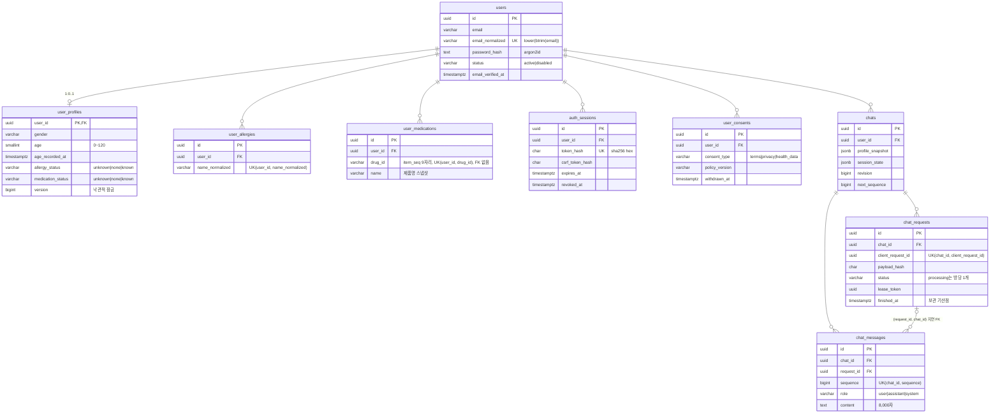

# 회원 DB (drug_app / drug_app_test)

회원·건강설정·상담 기록을 저장하는 DB입니다. 약품 검색용 DB(`drug_rag`)와 같은 EC2 PostgreSQL 15(포트 5433)에 있지만 **DB와 계정을 분리**했습니다.

- 회원 데이터는 다시 만들 수 없으므로 백업·복원을 따로 합니다. 약품 DB는 S3 덤프로 언제든 다시 만들 수 있습니다.
- 팀원용 `drug_reader` 계정은 회원 DB에 접속할 수 없습니다.
- 사용자 건강정보는 약품 벡터·그래프나 공유 ETL에 넣지 않습니다.
- WEB 개발용 테스트 DB(`drug_app_test`)를 같은 서버에 따로 둡니다. 계정·비밀번호가 운영과 달라 서로 접근할 수 없습니다.

설계 기준은 `DB_USER_SYSTEM_HANDOFF.md` 3장과 WEB 회신(`REPLY.md`)입니다. 결정 내역은 `DECISIONS.md`, 보강·반영 내용은 `migrations/V001__init.sql` 머리말에 있습니다.

## 파일

| 파일 | 내용 | 실행 계정 |
|---|---|---|
| `00_bootstrap.sql` | DB·계정·스키마 생성 (운영·테스트 공용, 다시 실행해도 안전) | superuser |
| `migrations/V001__init.sql` | 테이블 9개 + 운영 테이블 + 권한 | app_migrator |
| `migrate.sh` | migration을 순서대로 한 번씩 적용, 체크섬 기록 | app_migrator |
| `tests/test_v001.sql` | 제약·권한·CASCADE 동작 확인 (데이터를 넣고 지우므로 운영 DB 금지) | superuser → runtime 계정 |
| `ops/EC2_SECURITY.md` | SSL·pg_hba·scram 정리 절차 | 서버 관리자 |
| `ops/backup.sh` | 매일 `pg_dump` → S3 (SSE) | postgres (cron) |
| `ops/cleanup.sql` | 세션(종료 후 7일)·요청(종료 후 30일, 메시지 참조 없는 것만) 삭제 | postgres (cron, 하루 1회) |
| `ops/reclaim_leases.sql` | lease 만료 후 10분 지난 processing 요청 → failed | postgres (cron, 10분마다) |
| `ops/reapply_deletions.sql` | 백업 복원 후 탈퇴 회원 재삭제 | app_migrator |
| `app_db.env.example` | 백엔드용 `APP_DB_*` 템플릿 | — |

## 계정

| DB | 계정 | 권한 | 접속 상한 | 쓰는 곳 |
|---|---|---|---|---|
| `drug_app` | `app_migrator` | `app` 스키마 소유자 (DDL) | 2 | migration 실행할 때만 |
| `drug_app` | `app_runtime` | 테이블 SELECT/INSERT/UPDATE/DELETE만. `deleted_users`는 SELECT/INSERT만 | 8 | 운영 백엔드 |
| `drug_app_test` | `app_test_migrator` | 위와 같음 | 2 | 테스트 DB migration |
| `drug_app_test` | `app_test_runtime` | 위와 같음 | 5 | WEB 개발 |
| — | `drug_reader` | 회원 DB 둘 다 접속 불가 | — | 팀원 약품 DB 조회 |

접속 상한은 WEB 초기 구성(워커 1개 × 연결 4개)에 재배포 때 잠깐 겹치는 여유를 더한 값입니다.
runtime 계정 기본 설정: `search_path=app`, `timezone=UTC`, `statement_timeout=15s`, `idle_in_transaction_session_timeout=30s`, `lock_timeout=5s`.
비밀번호는 노션·Git에 적지 않습니다. 필요하면 DE 파트에 문의하세요.

## 적용 순서 (EC2)

테스트 DB를 먼저 만들어 WEB이 개발을 시작하게 하고, 운영 DB는 백엔드 IP(B1)를 받은 뒤 같은 방식으로 만듭니다.

0. 적용 전 확인 (Neo4j Browser에서): 9자리 숫자가 아닌 `item_seq`가 0건이어야 합니다. 있으면 DE가 V001의 `drug_id` 형식 제약을 조정합니다.
   ```cypher
   MATCH (d:Drug) WHERE NOT d.item_seq =~ '[0-9]{9}' RETURN count(d), collect(d.item_seq)[0..5]
   ```
1. `ops/EC2_SECURITY.md` 1~3단계 (설정 백업, SSL, scram)
2. 서버에 파일 올리기: `scp -i <키>.pem -r db/app ubuntu@43.200.194.39:~/drug_app`
3. 부트스트랩 (서버 안에서). 테스트 DB:
   ```bash
   cd ~/drug_app
   sudo -u postgres psql -p 5433 -v ON_ERROR_STOP=1 \
     -v db=drug_app_test -v migrator=app_test_migrator -v runtime=app_test_runtime -v runtime_limit=5 \
     -v migrator_pw='<비밀번호>' -v runtime_pw='<비밀번호>' -f 00_bootstrap.sql
   ```
   운영 DB는 `-v db=drug_app -v migrator=app_migrator -v runtime=app_runtime -v runtime_limit=8`로 바꿔 실행합니다.
   실행 후 `history -c`로 셸 기록을 지우세요. 비밀번호가 남습니다.
4. migration (서버 안에서. 127.0.0.1로 접속 — 소켓은 peer 인증이라 migrator 계정으로 로그인 불가). 테스트 DB:
   ```bash
   export APP_DB_HOST=127.0.0.1 APP_DB_PORT=5433 APP_DB_SSLMODE=prefer
   export APP_DB_NAME=drug_app_test APP_DB_MIGRATOR_USER=app_test_migrator APP_DB_RUNTIME_USER=app_test_runtime
   read -s APP_DB_MIGRATOR_PASSWORD && export APP_DB_MIGRATOR_PASSWORD
   ./migrate.sh && ./migrate.sh --status
   ```
   운영 DB는 `APP_DB_NAME=drug_app APP_DB_MIGRATOR_USER=app_migrator APP_DB_RUNTIME_USER=app_runtime`.
5. (테스트 DB만) 동작 확인: `sudo -u postgres psql -p 5433 -d drug_app_test -v runtime=app_test_runtime -f tests/test_v001.sql` → 마지막 줄 `fail = 0`.
   운영 DB에서는 실행하지 마세요.
6. `ops/EC2_SECURITY.md` 4단계(pg_hba) → 5~6단계(보안 그룹, 접속 확인)
7. cron 등록 (`ops/backup.sh` 머리말): 백업·cleanup 하루 1회, reclaim_leases 10분마다

스키마를 바꿀 때는 `migrations/V002__설명.sql`처럼 새 파일을 추가합니다. 이미 적용된 파일을 고치면 `migrate.sh`가 체크섬 불일치로 멈춥니다.
되돌리기도 새 migration으로 앞으로 고칩니다. 회원 테이블 DROP이나 무인증 API로 돌아가는 방식은 쓰지 않습니다.

## 로컬 테스트 (Docker)

```bash
docker exec -i drug_rag_postgres psql -U airflow -d postgres -v ON_ERROR_STOP=1 \
  -v db=drug_app -v migrator=app_migrator -v runtime=app_runtime -v runtime_limit=8 -v migrator_pw=local -v runtime_pw=local < 00_bootstrap.sql
docker cp . drug_rag_postgres:/tmp/drug_app
docker exec -e APP_DB_HOST=/var/run/postgresql -e APP_DB_PORT=5432 -e APP_DB_SSLMODE=disable -e APP_DB_MIGRATOR_PASSWORD=local \
  drug_rag_postgres bash /tmp/drug_app/migrate.sh
docker exec -i drug_rag_postgres psql -U airflow -d drug_app < tests/test_v001.sql   # 마지막 줄 fail = 0 이면 통과
```

## ERD



운영 테이블(ERD 생략): `schema_migrations`(적용 기록), `deleted_users`(탈퇴 id, 복원 후 재삭제용).

## 백엔드 구현 메모

- **탈퇴**: `INSERT INTO app.deleted_users(user_id)`와 `DELETE FROM app.users` 를 한 트랜잭션에서 실행합니다. 나머지는 CASCADE로 지워집니다.
- **`updated_at`, `finished_at`**: 트리거가 기록하므로 백엔드에서 넣지 않습니다. `finished_at`은 상태가 바뀔 때만 바뀝니다.
- **이메일**: 가입·로그인 모두 `lower(btrim(입력값))`으로 `email_normalized`를 만들어 조회합니다. `email`에는 입력 원본을 저장합니다.
- **복용약**: 검색 결과에서 고른 제품의 `item_seq`(숫자 9자리)만 저장합니다. 약품 DB와 FK가 없으니 저장 전에 `find_drug(otc_only=False)`로 존재를 확인하세요. 전문의약품도 허용합니다(병용금기 검사에 필요). 일반의약품 제한은 추천 결과에만 적용합니다.
- **비밀번호 해시**: `$argon2id$`로 시작하지 않으면 DB가 거부합니다.
- **본문 길이**: API가 8,000자(코드 포인트)를 먼저 검사합니다. DB는 같은 기준의 안전장치이며 잘라서 저장하지 않습니다. metadata 상한은 API에서만 검사합니다.
- **lease**: LLM 타임아웃 90초, 최초 lease 120초, 갱신 없음. 같은 상담방에 새 요청이 오면 API가 만료된 lease를 바로 `failed`로 회수합니다. 회수되지 않은 요청은 만료 10분 뒤 cron이 회수합니다.
- **결과 저장**: 반드시 `UPDATE ... WHERE id = ? AND lease_token = ?`로 상태를 바꾸고, 메시지 저장과 같은 트랜잭션에서 처리합니다. 0건이면 롤백합니다. 회수된 요청은 lease_token이 비워져 있어 늦게 끝난 worker의 결과가 저장되지 않습니다.
- **재시도 중복 방지 기간**: 완료된 요청은 메시지가 참조하므로 상담 삭제 전까지 남아 중복이 계속 막힙니다. 메시지 없이 끝난 요청은 종료 후 30일 뒤 삭제되고, 그 뒤 같은 `client_request_id`는 새 요청으로 취급됩니다.
